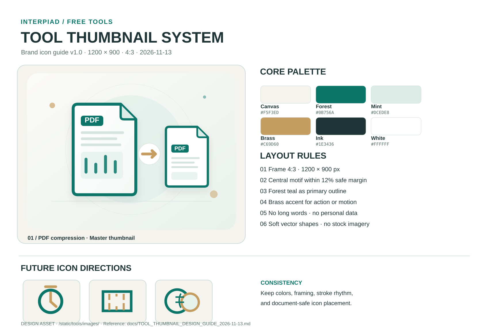

# 인터피아드 무료 업무도구 썸네일 디자인 가이드

적용일: 2026-11-13  
대상: 인터피아드의 **무료 업무도구** 카드 썸네일. 기존 거래명세표·견적서 등 **무료 업무서식의 실제 양식 미리보기**에는 적용하지 않는다.

## 1. 기준 원본

- 디자인시트: [tool-thumbnail-design-sheet.svg](../static/tools/images/tool-thumbnail-design-sheet.svg)
- 첫 아이콘: [pdf-compress-thumbnail.svg](../static/tools/images/pdf-compress-thumbnail.svg)
- 공개 위치: /tools/images/tool-thumbnail-design-sheet.svg, /tools/images/pdf-compress-thumbnail.svg
- 적용 카드: `/tools/apps/`의 **25종 전체 도구**(기존 PDF 압축 아이콘 1개 + 신규 SVG 24개)
- 웹 카드의 제목·상세 설명·버튼은 HTML로 출력한다. 썸네일 안에 긴 한글 문구나 버튼을 넣지 않는다.
- 썸네일은 실무 기능을 상징하는 벡터 그림으로 제작한다. 실제 서식의 빈 양식 캡처와 혼용하지 않는다.

## 2. 디자인 토큰 (정확한 코드)

| 용도 | HEX | 사용 규칙 |
|---|---|---|
| 기본 바탕 | `#F5F3ED` | 단색 바탕 및 카드 프레임 |
| 밝은 바탕 | `#FBFAF7` | 부드러운 그라데이션 시작 |
| 주색·윤곽선 | `#0B756A` | 주요 파일·도구 아이콘 |
| 보조 밝은색 | `#DCEDE8` | 그림 뒤 원형·보조 면 |
| 동작 강조 | `#C69D60` | 축소 화살표·시간 흐름 등 동작 |
| 주 문구 | `#1E3436` | 디자인시트의 문자, 필요한 소형 레이블 |
| 테두리 | `#CADCD5` | 장식선, 비활성 테두리 |
| 서류 면 | `#FFFFFF` | 문서 또는 도구 기기 정면 |

## 3. 썸네일 제작 규격

- 원본 캔버스: **1200 × 900px (4:3)**. `viewBox="0 0 1200 900"` 유지.
- 저장 형식: **SVG 우선**. SVG는 확대 시 깨지지 않으며 미래 아이콘을 동일한 크기와 질감으로 만들기 쉽다.
- 시각 중심: 가운데 **실제 기능을 보여 주는 1개의 주제 아이콘**을 크게 배치한다. 보조 그림과 동작 화살표는 주제를 설명하는 정도로 제한한다.
- 안전 영역: 캔버스의 좌우 12%(각 144px), 위아래 12%(각 108px) 안쪽에 주요 그림 배치. 가장자리 요소는 가벼운 장식만 허용.
- 공통 형태: 둥근 모서리, 짙은 청록색 윤곽선, 연한 민트색 보조 면, 금색 동작 포인트, 은은한 그림자.
- 텍스트: 꼭 필요한 파일 약어(예: PDF)만 허용. 한글 제목, 다운로드 버튼, 퍼센트나 광고 문구를 썸네일에 넣지 않는다.
- 개인정보: 실제 업체명·파일명·도장·주소·전화번호·로고 복제 금지. 제삼자 브랜드·실제 서비스 캡처를 표기하지 않는다.
- SVG에 외부 이미지를 로딩하거나 JS, 링크, 폰트 파일, `foreignObject`를 넣지 않는다.
- 파일명: `static/tools/images/{tool-slug}-thumbnail.svg`.
- 새 파일을 올릴 때 `content/...md`의 `previewImage`, `previewWidth: 1200`, `previewHeight: 900`, `previewAlt`, `previewCaption`을 함께 작성한다.
- 같은 아이콘을 여러 도구에 복사해 바꾸지 않는다. 색·배치 원칙만 공유하고, 주제별로 형태는 구별한다.

## 4. 다음 아이콘을 만드는 절차

1. 기능을 1문장으로 정의한다. 예: 타이머(원형 시계와 초침), 면적 변환(눈금자), 환율(겹친 통화 동전).
2. 기본 4:3 바탕과 컬러 팔레트, 안전 여백을 위 디자인시트에서 가져온다.
3. 주제 아이콘을 중앙에 크게 배치하고 **금색은 동작 한 곳**에만 쓴다.
4. 320px 모바일 카드와 1440px PC 카드에서 축소 가독성을 확인한다.
5. SVG를 1개 파일로 저장하고 Hugo의 카드 메타데이터와 이미지 alt를 추가한다.
6. 기존 아이콘·서식 미리보기·파일 이름은 건드리지 않고 스냅샷 QA 후 반영한다.

## 5. 25종 썸네일 추가 규칙

2026-11-13 추가: 앱별 SVG 24개를 static/tools/images/{tool-key}-thumbnail.svg 경로에 등록했습니다. 기존 PDF 아이콘의 바탕색, 윤곽선, 원형 보조면, 금색 포인트와 1200×900 규격을 재사용하되 개별 도구마다 다른 기하학적 실루엣을 표시합니다. HTML 카드의 제목·설명은 SVG에 복제하지 않습니다.

## 6. 사이트 배치 및 검수

- 무료 업무도구 목록: `/tools/apps/` (`content/tools/apps/_index.md`, `layouts/toolapps/list.html`).
- 무료 업무서식 목록: **기존** `/tools/` (`content/tools/_index.md`, `layouts/tools/list.html`).
- PDF 압축 실행: **기존** `/tools/pdf-compress/`. 주소와 원래 압축 동작을 유지한다.
- 메인 메뉴·상세 페이지의 현재 위치 표시를 각각 `aria-current="page"`로 구분한다.
- 카드 공통 CSS: `static/tools/tools-index.css`, `tools-grid`·`tools-card`·`tools-preview`. 아이콘 전용 스타일은 `tools-preview--icon`으로 분리한다.
- PNG/JPEG 고정 썸네일로 변경할 경우 정확한 파일 용량·크기와 채택 이유를 이 가이드에 기록한다.
- UI 정렬, 이미지 로딩, 링크, 브라우저 폭, 스크린샷, 기존 서식 5종, PDF 압축 파일 전송 여부를 확인한 뒤 배포한다.

**금지:** PDF 원본을 서버로 보내는 기능 추가, 기존 서식 이미지 대신 AI 그림 적용, 미확인 경로로 강제 이동, 기존 운영 페이지를 불필요하게 재생성.
